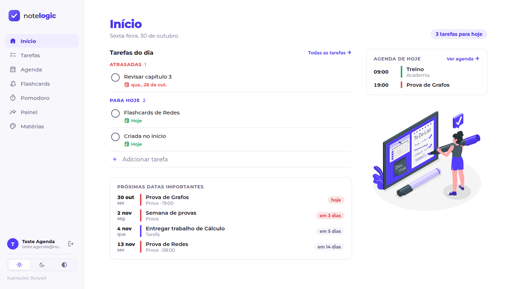
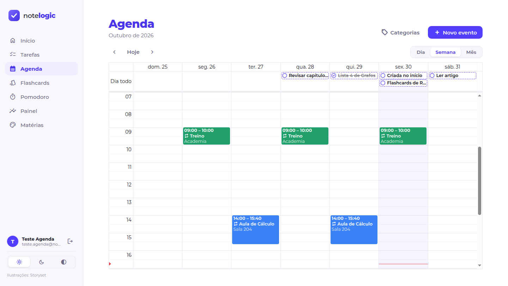
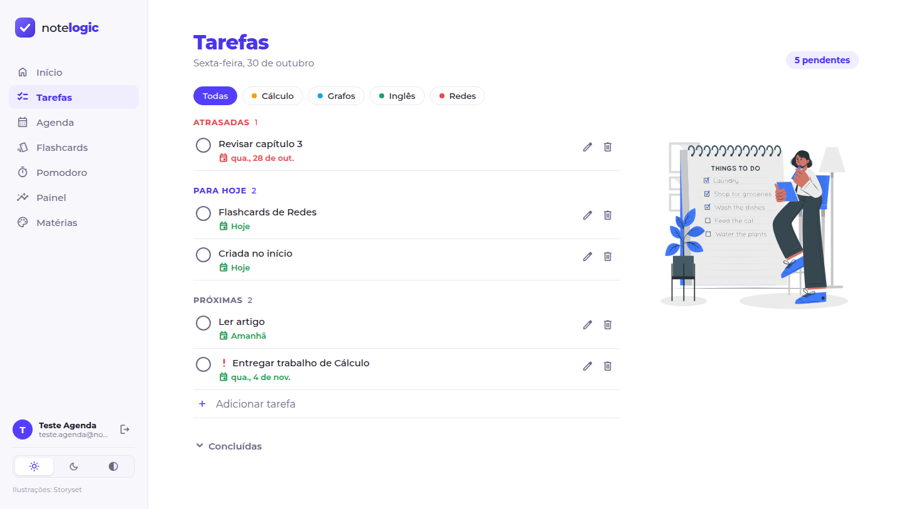
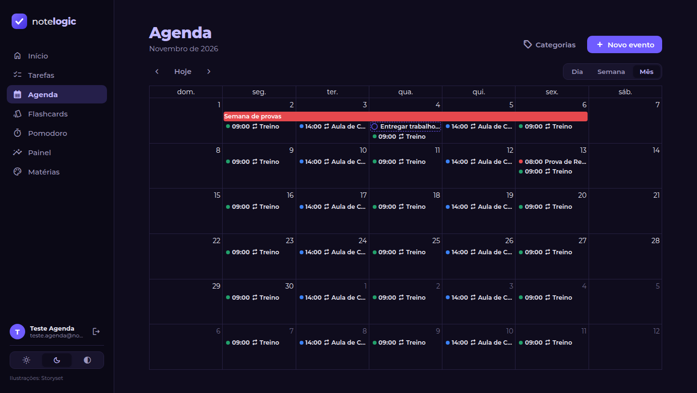
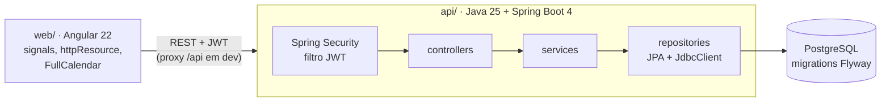

# NoteLogic

Aplicativo de estudos que junta **tarefas**, **agenda**, **flashcards com revisão espaçada** e **pomodoro** num
lugar só, com um **painel** que mostra como os estudos estão indo. Tudo gira em torno das **matérias**: uma tarefa,
um evento, um baralho e uma sessão de foco pertencem a uma matéria, e o painel cruza tudo isso.

**Java 25 + Spring Boot 4** na API, **Angular 22** no front e **PostgreSQL** no banco. É a versão 2 do
[NoteLogic original em Django](https://github.com/Guilhermedantass/NoteLogic-django), reescrita do zero.



<table>
  <tr>
    <td width="50%"></td>
    <td width="50%"></td>
  </tr>
  <tr>
    <td></td>
    <td></td>
  </tr>
  <tr>
    <td></td>
    <td></td>
  </tr>
</table>

## O que ele faz

- **Início:** a tela que abre depois do login, só com o que é do dia: as tarefas atrasadas e de hoje, os eventos de
  hoje e as **próximas datas importantes** (provas e entregas de prioridade alta nos próximos 30 dias, com
  contagem regressiva).
- **Tarefas:** prazo, prioridade e matéria, agrupadas em atrasadas, para hoje, próximas e sem prazo.
- **Tarefas que se repetem:** todo dia, dias úteis, dias da semana escolhidos, a cada N dias ou todo mês. Cada uma
  escolhe se, quando não é feita no dia, **expira** ou **vira atrasada**. Editar e apagar perguntam "só esta" ou
  "esta e as próximas", e a lista mostra a constância ("18/20").
- **Agenda:** semana, mês e dia, com os **eventos** (prova, aula, treino) e as tarefas com prazo. O que se *conclui*
  é tarefa; o que *acontece* num horário é evento.
  - **Rotina:** eventos que se repetem ("treino segunda, quarta e sexta às 9h"), com as mesmas regras das tarefas.
    Dá para mudar ou cancelar **só uma** ocorrência ("hoje não tem aula") ou dividir a série a partir de um dia.
  - **Categorias** com nome e cor. As marcadas com estrela (Prova, por exemplo) viram **datas importantes** no
    Início.
  - Arrastar muda o dia ou o horário; clicar num espaço vazio cria um evento ali.
- **Flashcards com SM-2:** o algoritmo de repetição espaçada que é a base do Anki. Você responde *Errei / Difícil /
  Bom / Fácil* e o cartão volta no momento certo de ser lembrado; cada botão já mostra quando ("1 dia", "6 dias").
  O cartão vira em 3D e dá para estudar só pelo teclado.
- **Pomodoro:** sessões de foco ligadas a uma tarefa ou matéria. O timer sobrevive a F5 e à aba em segundo plano,
  toca um alarme, manda notificação e sugere a pausa (longa a cada 4 focos).
- **Painel:** sequência de dias estudando, minutos por dia e por matéria, taxa de acerto e um heatmap do último ano.
- **Contas:** cadastro e login com JWT; cada pessoa só enxerga os próprios dados.
- **Tema claro e escuro** (ou seguir o sistema), escolhido na barra lateral.

O que vem pela frente (deploy, Kanban, banco de questões...), as decisões de produto e as ideias em discussão estão
no **[roadmap](docs/ROADMAP.md)**.

## Arquitetura



A API é organizada **por funcionalidade** (`tarefa/`, `recorrencia/`, `agenda/`, `materia/`, `flashcard/`,
`pomodoro/`, `estatistica/`, `usuario/`), cada pacote com controller, service, repository e DTOs. O front segue a
mesma divisão, com uma pasta por tela.

## Decisões que valem a pena olhar

| Onde | O quê |
|---|---|
| `api/.../flashcard/AgendadorSm2.java` | SM-2 como **lógica pura** (sem Spring nem banco), testado com JUnit puro. O front tem uma cópia só para *prever* os intervalos, testada com **os mesmos casos** do Java. |
| `api/.../recorrencia/` | A regra de repetição é guardada, e cada dia vira uma tarefa comum **sob demanda** (ao listar), sem job à meia-noite. O calendário é lógica pura testada com casos de borda (dia 31 em fevereiro, ano bissexto); uma trava pessimista e um índice único impedem ocorrências duplicadas. |
| `api/.../recorrencia/RegraRecorrencia.java` | A regra é um **record `@Embeddable`**: tarefas recorrentes e eventos guardam as colunas da regra na própria tabela e usam o mesmo cálculo de datas. |
| `api/.../agenda/EventoService.java` | As ocorrências de um evento que se repete **não são salvas**: são calculadas para o período pedido. "Só esta" vira uma linha de exceção (cancelada ou movida); "esta e as próximas" encerra a série na véspera e cria outra, como o Google Agenda. Um limite de "N vezes" continua valendo para as duas partes juntas. |
| `api/.../agenda/PeriodoEvento.java` + `V8__*.sql` | As regras de data e hora (fim depois do início, dia inteiro sem horário...) ficam no domínio **e** como `check` no banco. Data e hora são guardadas **sem fuso**: "treino às 9h" é 9h no relógio o ano todo. |
| `api/.../config/Relogio.java` | O "agora" é um `Clock` injetado. Os testes controlam o tempo e provam, por exemplo, que 23h30 de domingo em São Paulo conta como domingo. |
| `api/.../pomodoro/SessaoFoco.java` + `V4__*.sql` | A entidade é uma máquina de estados; um **índice único parcial** no Postgres garante uma sessão em andamento por usuário, mesmo com duas requisições simultâneas. |
| `api/.../estatistica/EstatisticaConsultas.java` | As agregações saem do JPA para **SQL com `JdbcClient`**: agrupar por dia no fuso do usuário é trabalho do banco. |
| `api/.../erro/TratadorDeErros.java` | Todos os erros no formato **ProblemDetail** (RFC 9457): 400, 401, 404, 409 e 422 com o mesmo formato, que o front lê. |
| `api/.../config/Seguranca.java` | API **stateless** com JWT (HS256) e senhas em **BCrypt**. Dado de outro usuário responde 404 (e não 403), para não revelar que o id existe. |
| `web/.../agenda/` | O FullCalendar só desenha: os dados vêm da API a cada período mostrado, e o visual usa as variáveis de cor do app, então o calendário troca de tema junto com o resto. A tradução API → calendário (`calendario.ts`) é lógica pura, testada sem montar a tela. |
| `web/.../pomodoro/pomodoro.ts` | O timer não conta para baixo: calcula `fimPrevisto − agora` a cada tick, então não atrasa quando o navegador desacelera a aba. |
| `web/.../painel/` | Gráficos em HTML/CSS feitos à mão, sem biblioteca. A escala de cor do heatmap foi validada (contraste e degraus) nos dois temas. |

## Testes

- **API:** 104 testes. Unitários para o SM-2, o calendário de repetição e a sequência de dias; de integração com
  **Testcontainers** (Postgres de verdade) e MockMvc para cada módulo, incluindo a repetição de eventos ("só esta",
  "esta e as próximas", limite de vezes), o fluxo real de login com JWT e testes de **isolamento entre usuários**
  (um não vê, não altera e não usa nada do outro).
- **Web:** 24 testes com Vitest (datas, SM-2, conversão para o calendário, gráficos, expiração do token, layout).

```bash
cd api && ./mvnw test        # precisa do Docker rodando (Testcontainers)
cd web && npx ng test --watch=false
```

## Como rodar

Pré-requisitos: **Java 25**, **Node 24** e **Docker**.

```bash
# API (porta 8080). O Postgres sobe sozinho pelo compose.yaml (spring-boot-docker-compose).
cd api
./mvnw spring-boot:run

# Front (porta 4200), em outro terminal. O ng serve repassa /api para a 8080.
cd web
npm install
npx ng serve
```

Abra http://localhost:4200 e crie uma conta. Ela já vem com as categorias da agenda (Prova, Aula, Treino e
Compromisso).

> Em produção, defina a variável de ambiente `NOTELOGIC_JWT_SEGREDO` (32+ caracteres aleatórios); o valor do
> `application.properties` é só para desenvolvimento.

## Estrutura

```
api/                      Spring Boot
  src/main/java/dev/guilherme/notelogic/
    tarefa/ recorrencia/ agenda/ materia/ flashcard/ pomodoro/ estatistica/ usuario/   um pacote por funcionalidade
    config/               segurança (JWT) e relógio
    erro/                 exceções de domínio e o tratador global
  src/main/resources/db/migration/                                V1 a V9 (Flyway)
web/                      Angular
  src/app/
    inicio/ tarefas/ agenda/ materias/ flashcards/ pomodoro/ painel/ auth/   uma pasta por tela
    core/                 services HTTP, interceptor, guard, modelos e funções puras
    layout/               shell, barra lateral, marca e janela (modal)
docs/
  ROADMAP.md              próximas features, decisões de produto e ideias em aberto
  prints/                 imagens deste README
```

## Créditos

Ilustrações das telas de entrada, Início e Tarefas: [Storyset](https://storyset.com).
