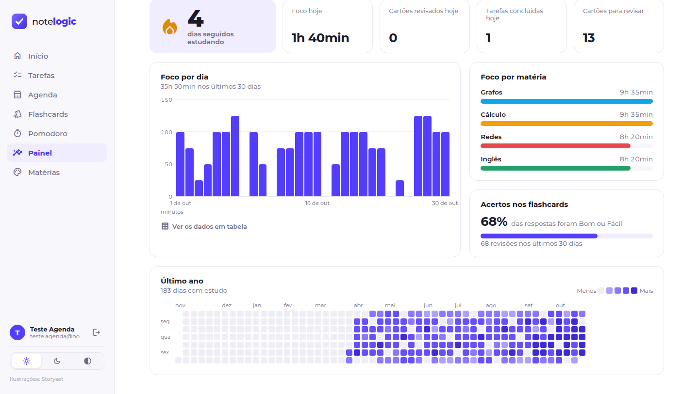
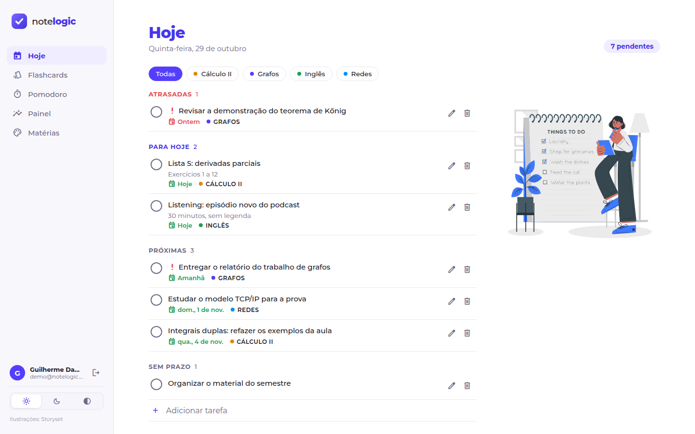
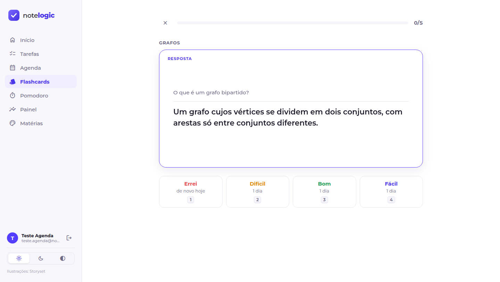
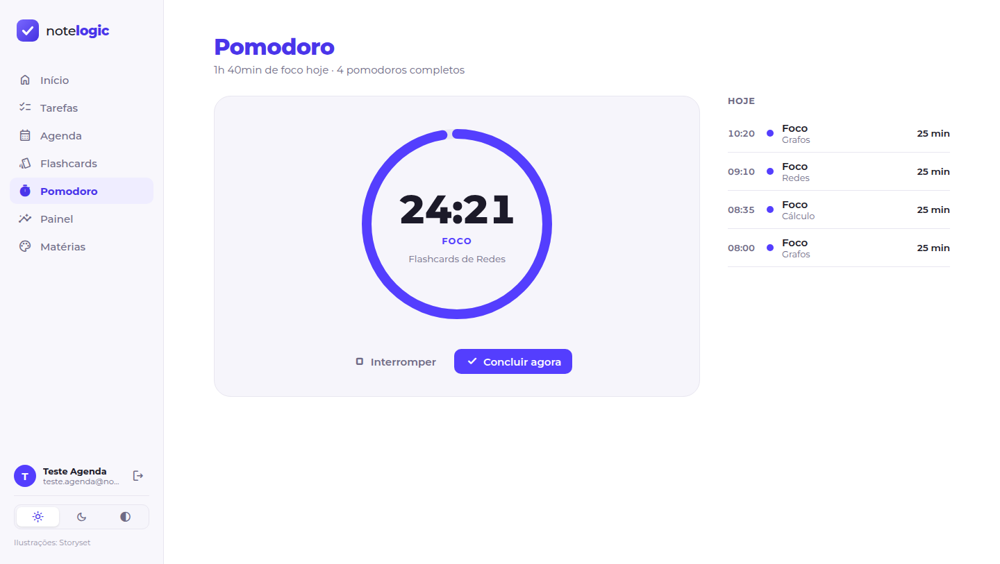
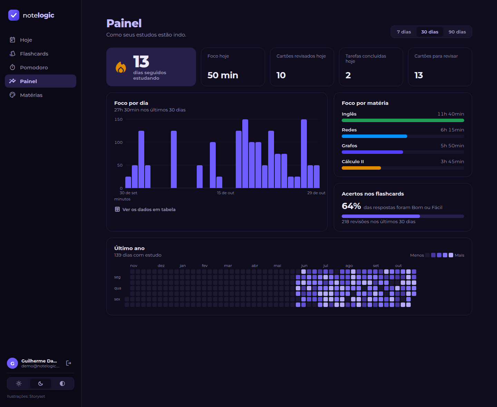
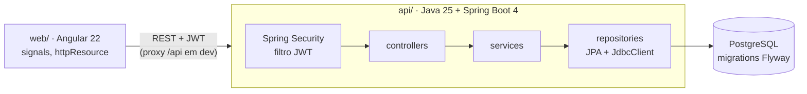

# NoteLogic

Aplicativo de estudos que junta **tarefas**, **flashcards com revisão espaçada** e **pomodoro** num lugar só, com um
**painel** que mostra como os estudos estão indo. Tudo gira em torno das **matérias**: uma tarefa, um baralho e uma
sessão de foco pertencem a uma matéria, e o painel cruza os três.

API em **Java 25 + Spring Boot 4**, front em **Angular 22**, banco **PostgreSQL**. É a versão 2 do
[NoteLogic original em Django](https://github.com/Guilhermedantass/NoteLogic-django), reescrita do zero.



<table>
  <tr>
    <td></td>
    <td></td>
  </tr>
  <tr>
    <td></td>
    <td></td>
  </tr>
</table>

## O que ele faz

- **Tarefas:** prazo, prioridade e matéria; a tela "Hoje" agrupa em atrasadas, para hoje, próximas e sem prazo.
- **Tarefas que se repetem:** todo dia, dias úteis, dias da semana escolhidos, a cada N dias ou todo mês. Cada uma
  escolhe se, quando não é feita no dia, **expira** ou **vira atrasada**; editar e apagar perguntam "só esta" ou
  "esta e as próximas", e a lista mostra a constância ("18/20").
- **Flashcards com SM-2:** o algoritmo de repetição espaçada que é a base do Anki. Você responde *Errei / Difícil /
  Bom / Fácil* e o cartão volta no momento certo de ser lembrado; cada botão já mostra quando ("1 dia", "6 dias").
  Cartão vira em 3D e dá para estudar só pelo teclado.
- **Pomodoro:** sessões de foco ligadas a uma tarefa ou matéria. O timer sobrevive a F5 e a aba em segundo plano,
  toca um alarme, manda notificação e sugere a pausa (longa a cada 4 focos).
- **Painel:** sequência de dias estudando, minutos por dia e por matéria, taxa de acerto e um heatmap do último ano.
- **Contas:** cadastro e login com JWT; cada pessoa só enxerga os próprios dados.
- **Tema claro e escuro**, escolhido na barra lateral.

## Arquitetura



A API é organizada **por funcionalidade** (`tarefa/`, `materia/`, `flashcard/`, `pomodoro/`, `estatistica/`,
`usuario/`), cada pacote com controller, service, repository e DTOs. O front segue a mesma divisão.

## Decisões que valem a pena olhar

| Onde | O quê |
|---|---|
| `api/.../flashcard/AgendadorSm2.java` | SM-2 como **lógica pura** (sem Spring nem banco), testado com JUnit puro. O front tem uma cópia só para *prever* os intervalos, testada com **os mesmos casos** do Java. |
| `api/.../recorrencia/` | A regra de repetição é guardada, e cada dia vira uma tarefa comum **sob demanda** (ao listar), sem job à meia-noite. O calendário é lógica pura testada com casos de borda (dia 31 em fevereiro, ano bissexto); uma trava pessimista e um índice único impedem ocorrências duplicadas. |
| `api/.../config/Relogio.java` | O "agora" é um `Clock` injetado. Os testes controlam o tempo e provam, por exemplo, que 23h30 de domingo em São Paulo conta como domingo. |
| `api/.../pomodoro/SessaoFoco.java` + `V4__*.sql` | A entidade é uma máquina de estados; um **índice único parcial** no Postgres garante uma sessão em andamento por usuário, mesmo com duas requisições simultâneas. |
| `api/.../estatistica/EstatisticaConsultas.java` | As agregações saem do JPA para **SQL com `JdbcClient`**: agrupar por dia no fuso do usuário é trabalho do banco. |
| `api/.../erro/TratadorDeErros.java` | Todos os erros no formato **ProblemDetail** (RFC 9457): 400, 401, 404, 409 e 422 com o mesmo formato, que o front lê. |
| `api/.../config/Seguranca.java` | API **stateless** com JWT (HS256) e senhas em **BCrypt**. Dado de outro usuário responde 404 (e não 403), para não revelar que o id existe. |
| `web/.../pomodoro/pomodoro.ts` | O timer não conta para baixo: calcula `fimPrevisto − agora` a cada tick, então não atrasa quando o navegador desacelera a aba. |
| `web/.../painel/` | Gráficos em HTML/CSS feitos à mão, sem biblioteca. A escala de cor do heatmap foi validada (contraste e degraus) nos dois temas. |

## Testes

- **API:** 76 testes. Unitários para o SM-2 e a sequência de dias; de integração com **Testcontainers** (Postgres de
  verdade) e MockMvc para cada módulo, incluindo o fluxo real de login com JWT e testes de **isolamento entre
  usuários** (um não vê, não altera e não usa nada do outro).
- **Web:** 18 testes com Vitest (datas, SM-2, gráficos, expiração do token, layout).

```bash
cd api && ./mvnw test        # precisa do Docker rodando (Testcontainers)
cd web && npx ng test --watch=false
```

## Como rodar

Pré-requisitos: **Java 25**, **Node 24** e **Docker**.

```bash
# API (porta 8080). O Postgres sobe sozinho pelo compose.yaml (spring-boot-docker-compose).
cd api
./mvnw spring-boot:run

# Front (porta 4200), em outro terminal. O ng serve repassa /api para a 8080.
cd web
npm install
npx ng serve
```

Abra http://localhost:4200 e crie uma conta.

> Em produção, defina a variável de ambiente `NOTELOGIC_JWT_SEGREDO` (32+ caracteres aleatórios); o valor do
> `application.properties` é só para desenvolvimento.

## Estrutura

```
api/                      Spring Boot
  src/main/java/dev/guilherme/notelogic/
    tarefa/ materia/ flashcard/ pomodoro/ estatistica/ usuario/   um pacote por funcionalidade
    config/               segurança (JWT) e relógio
    erro/                 exceções de domínio e o tratador global
  src/main/resources/db/migration/                                V1 a V7 (Flyway)
web/                      Angular
  src/app/
    tarefas/ materias/ flashcards/ pomodoro/ painel/ auth/        uma pasta por tela
    core/                 services HTTP, interceptor, guard, modelos e funções puras
    layout/               shell, barra lateral e marca
docs/prints/              imagens deste README
```

## Créditos

Ilustrações das telas de entrada e de tarefas: [Storyset](https://storyset.com).
